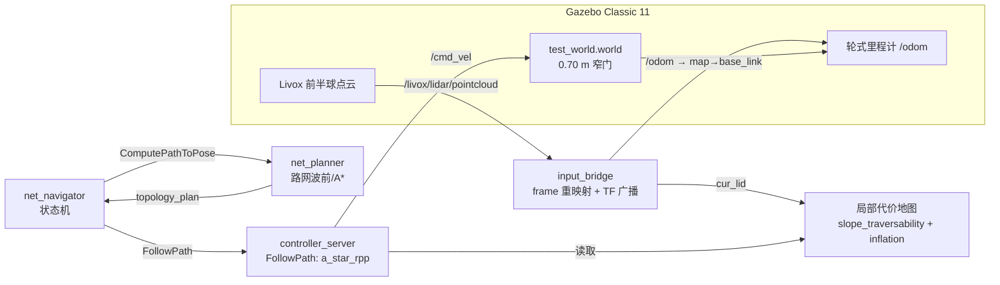
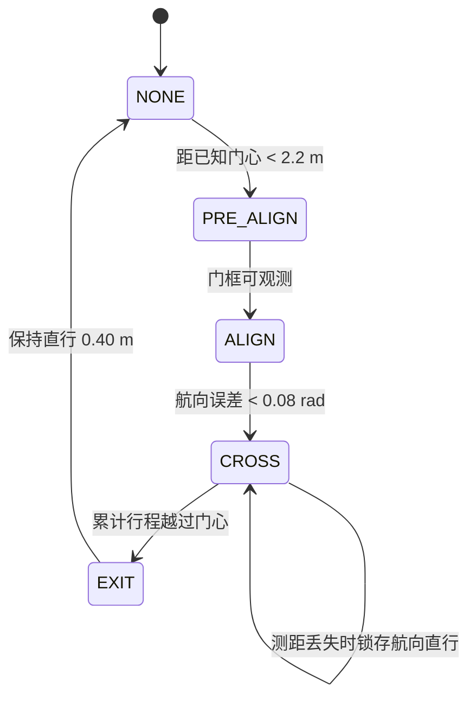
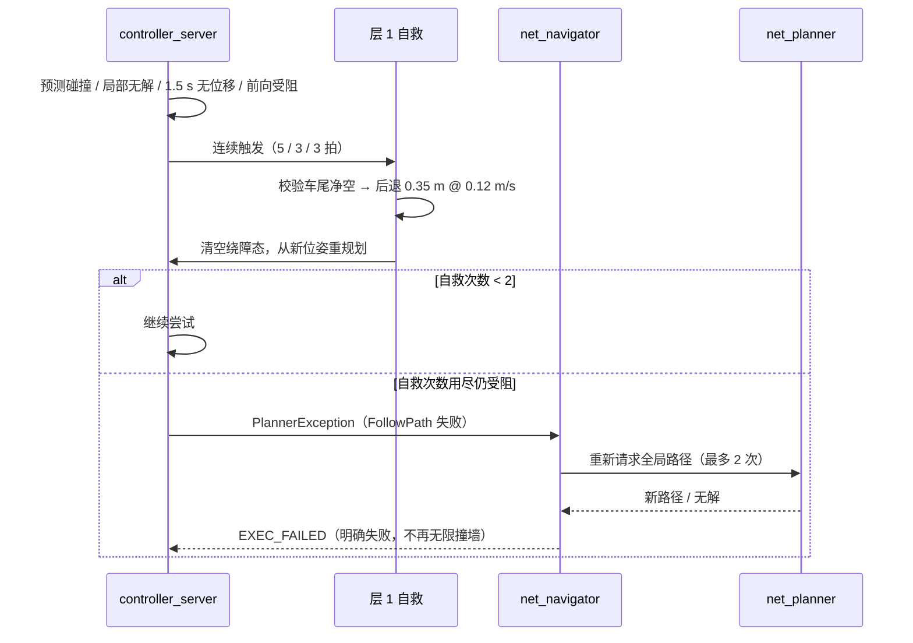
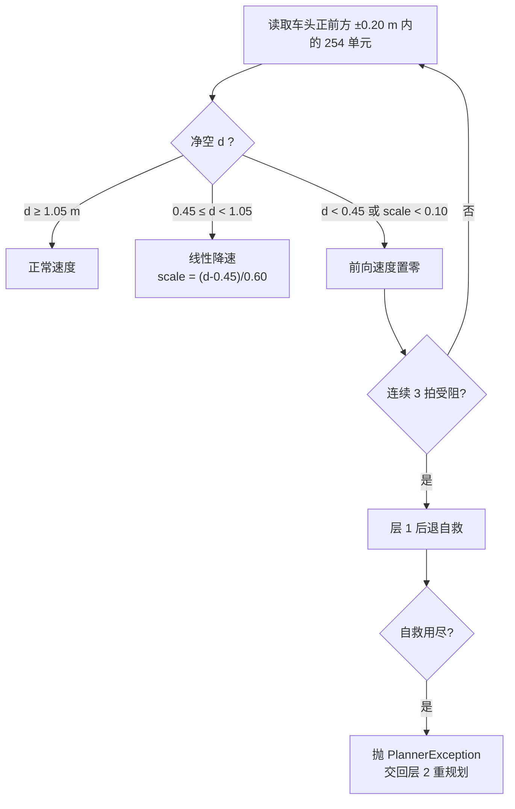

# 南湖科研导航工作空间 · nanhu-research-navigation

<p>
  
  
  
  
  
</p>

> 基于 **ROS 2 Humble** 的轮式机器人**路网拓扑导航**研究与仿真工作空间。
> 以「路网图 + 图搜索」替代栅格全局规划，在 Nav2 `controller_server` 内实现
> **Theta\* 局部绕障 + 定宽窄门穿越 + 两级故障恢复**，并配套一套可复现的 Gazebo 仿真环境。

本仓库聚焦**导航算法与控制器**：路网规划、局部代价地图、门区伺服、卡死自救与全局重规划。
定位（FAST-LIVO2）、雷达/底盘驱动、MAVROS 等属于外部依赖，不在本仓库内（详见 [doc/PROJECT_GUIDE.md](doc/PROJECT_GUIDE.md)）。

---

## 目录

- [项目简介](#项目简介)
- [核心特性](#核心特性)
- [系统架构](#系统架构)
- [仓库结构](#仓库结构)
- [关键设计](#关键设计)
  - [1. 路网拓扑全局规划](#1-路网拓扑全局规划)
  - [2. 0.70 m 窄门穿越](#2-070-m-窄门穿越)
  - [3. 局部代价地图：253 与 254 的区别](#3-局部代价地图253-与-254-的区别)
  - [4. 两级故障恢复](#4-两级故障恢复)
  - [5. 前向停车保护](#5-前向停车保护)
- [环境依赖](#环境依赖)
- [编译](#编译)
- [运行（Gazebo 仿真）](#运行gazebo-仿真)
- [关键参数](#关键参数)
- [验证结果](#验证结果)
- [常见问题](#常见问题)
- [文档索引](#文档索引)
- [脚本索引](#脚本索引)
- [致谢与说明](#致谢与说明)

---

## 项目简介

| 项目 | 说明 |
| --- | --- |
| 全局规划 | 路网拓扑图（节点 + 边）上的波前 / A\* 搜索，输出稀疏路网路径并按 0.1 m 加密 |
| 局部规划 | `nav2_a_star_rpp` 内的 Theta\* 栅格绕障，与纯跟踪（RPP）指令逐周期仲裁 |
| 控制器 | 改造版 Regulated Pure Pursuit：路径冻结、门区四阶段伺服、层 1 自救 |
| 任务编排 | `net_navigator` 状态机串联规划 / 跟踪 / 恢复，失败后触发全局重规划（层 2） |
| 感知 | Livox 前半球点云 → `SlopeTraversabilityLayer` 坡度可通行层 → 局部代价地图 |
| 仿真 | Gazebo Classic 11 + Livox 模型 + 履带底盘 URDF，`test_world.world` 含 0.70 m 窄门 |

一句话：**车沿路网走，遇到局部障碍用 Theta\* 绕，遇到窄门交给门区状态机，走不动就先自救、再交给全局重新规划。**

---

## 核心特性

- **路网拓扑导航**：全局路径不依赖栅格 A\*，长距离规划快、路径稳定，适合结构化园区道路。
- **Theta\* 局部绕障**：局部代价地图内实时搜索，绕障后仍回到原路网折线。
- **0.70 m 窄门穿越**：门框测距伺服 + 四阶段状态机（PRE_ALIGN → ALIGN → CROSS → EXIT），
  门宽小于常规判障净宽时仍可稳定通过。
- **坡度可通行层**：15° 坡道被识别为可通行，薄板边沿、台阶与真障碍被标记为致命。
- **两级故障恢复**：
  - 层 1（控制器内）：预测碰撞 / 局部无解 / 无位移 / 前向受阻 → 后退 0.35 m 后重新规划；
  - 层 2（`net_navigator`）：层 1 用尽后重新请求全局路径，最多重试 2 次，最终明确失败。
- **前向停车保护**：只认代价地图 `LETHAL_OBSTACLE(254)`，在 1.05 m 开始线性降速、0.45 m 停车，
  避免高速顶墙与「停车贴脸」。
- **可观测**：`nav2_log_record` 记录事件与轨迹，`tools/monitor_nav.py` 可在线监视导航状态。

---

## 系统架构



**话题约定**

| 话题 | 类型 | 说明 |
| --- | --- | --- |
| `/goal_pose` | `geometry_msgs/PoseStamped` | 目标点，**map 系米制坐标**（非经纬度） |
| `/odom` | `nav_msgs/Odometry` | 仿真里程计，桥接后发布 `map → base_link` |
| `cur_lid` | `sensor_msgs/PointCloud2` | 裁剪后的雷达点云，代价地图与门区伺服共用 |
| `topology_plan` | `nav_msgs/Path` | 路网全局路径 |
| `/cmd_vel` | `geometry_msgs/Twist` | 控制器输出 |

---

## 仓库结构

```text
nanhu-research-navigation/
├── src/
│   ├── navigation2/                  # 导航核心（Nav2 1.1.18 基线 + 自研改造）
│   │   ├── controller/nav2_a_star_rpp/   # ★ RPP + Theta* 局部绕障、门区四阶段、层 1 自救
│   │   ├── controller/nav2_controller/   # controller_server
│   │   ├── planner/nav2_net_planner/     # 路网拓扑规划（SNN 波前 / A*）
│   │   ├── planner/nav2_scan_planner/    # 扫描式局部规划
│   │   ├── map/nav2_costmap_2d/          # 代价地图 + SlopeTraversabilityLayer
│   │   ├── system/nav2_net_system/       # net_navigator 状态机（层 2 重规划）
│   │   ├── system/nav2_log_record/       # 日志落盘
│   │   ├── bridge/nav2_input_bridge/     # 里程计/点云/GPS 桥接
│   │   └── common/                       # nav2_core、nav2_msgs、nav_2d_* 等
│   ├── robot_launch/                 # launch / config / maps / rviz（纯 Python 包）
│   ├── gazebo_sim/                   # 独立工作空间：Gazebo 世界、车辆、Livox 与 RealSense 模型
│   │   ├── vehicle_gazebo_sim/
│   │   ├── livox_laser_simulation_RO2/
│   │   ├── livox_ros_driver2/
│   │   └── realsense_gazebo_plugin/
│   ├── traversability_obstacle_cloud/ # 深度相机单帧地面/障碍/边界提取
│   ├── camera_boundary_navigation/    # 无 odom 的相机单边道路跟随
│   ├── plan_env/                      # 地形/深度网格环境建模
│   └── driver/rs_lidar_driver/        # RoboSense 雷达驱动（预留）
├── map_edit/                         # 路网 / 地图编辑工具
├── scripts/                          # 编译、启动、建图、录制、测试脚本
├── tools/                            # monitor_nav.py 等运维工具
├── doc/                              # 设计与学习文档（见文档索引）
├── 3party/fmt/8.1.1/                 # fmt 格式化库
└── .gitignore                        # 已排除 build/ install/ log/ logs/ 等产物
```

> 语言构成：C++ 约 90%，CMake 约 2.4%（其余为 Python / 配置）。

---

## 关键设计

### 1. 路网拓扑全局规划

传统 Nav2 用栅格 A\* 做全局规划，代价是路径贴障碍、长距离搜索慢。本项目改为：

- 路网文件（`src/robot_launch/maps/topo_map_*.yaml`）定义节点与边，自定义格式：
  `node: id type mapId east north up lat lon alt`、`edge: id type mapId from to obt`；
- `nav2_net_planner` 在拓扑图上搜索，输出路径并按 `dense_path_step: 0.1` 加密；
- `max_snap_distance: 4.0` 允许从任意位置吸附到最近路网节点（最长边 6.4 m，可在中段重启）。


### 2. 0.70 m 窄门穿越

测试世界中的窄门净宽 **0.70 m**，门柱尺寸 0.15 × 1.0 × 2.0 m。车体宽 0.46 m、内切半径 0.23 m，
常规「膨胀后判障」会把整条门洞染成不可通行，因此门段由控制器**直接测距伺服**接管：



- 已知门心写入 `door_positions`（map 系），LiDAR 尚未看到门柱时即可开始预对准，避免拐角过冲；
- `door_hold_distance: 0.50`：距门框过近时锁存航向直行，不再相信发散的测宽；
- 门区全程绕过常规规划器，退出时清空冻结的绕障态，防止旧路径跨门触发「连线受阻」误判。

门区几何（`test_world.world`）：

```text
            y=8.85  ┌──┐ 门柱 0.15×1.0×2.0
                    │  │
     走廊  ────────►│  │◄────────  走廊
                    │  │        净开 0.70 m
            y=7.15  └──┘
                    x=10.5
```

### 3. 局部代价地图：253 与 254 的区别

这是本项目最容易踩坑的一点：

| 代价值 | 含义 | 窄门/走廊里的表现 |
| --- | --- | --- |
| `253` | 内切障碍（inscribed） | 膨胀后**整片地面**都是 253，不能用来测「前方还有多远」 |
| `254` | `LETHAL_OBSTACLE`（真障碍） | 只有坡度层真正标记的墙、台阶、障碍物 |

因此：

- 碰撞判定阈值 `lethal_cost: 253`（避免门洞被过度保守地判死）；
- **前向停车测距只认 254**（否则会把地面当墙，车一动就「看见墙」）；
- `inflation_radius: 0.45`，避免 0.7 m 门洞两侧膨胀区重叠把通道堵死；
- `SlopeTraversabilityLayer`：`max_slope_deg: 20` 把 15° 坡道判为可通行，
  `max_step_height: 0.10` 拦住台阶与薄板边沿。

### 4. 两级故障恢复



层 1 的三个关键细节：

1. **位移锚点用轮式里程计实测**，不用开环指令累加——车被物理阻挡时也能识别「没退成」；
2. 后退过程中若 **1.5 s 位移无增长**，立即中止后退（车尾无点云，只能靠受阻判据兜底）；
3. 后退前校验 `recovery_rear_clearance`，车尾走廊不足时宁可不退，避免退进墙里。

### 5. 前向停车保护



> 「scale < 0.10 也算受阻」是必要的兜底：否则车会以几毫米每秒的速度贴着障碍爬行，
> 既走不动也不会触发自救，表现为「卡住了但离障碍特别近」。

---

## 环境依赖

| 依赖 | 版本 / 说明 |
| --- | --- |
| Ubuntu | 22.04 |
| ROS 2 | Humble |
| Gazebo | Classic 11.15（`gazebo_ros_pkgs`） |
| Nav2 | 1.1.18 基线（本仓库内已包含改造后的源码） |
| 编译 | `colcon` + `cmake`，C++17 |
| 其他 | `tf2`、`pcl`、`eigen`、`fmt`（`3party/fmt/8.1.1`） |

安装基础依赖：

```bash
sudo apt update
sudo apt install -y ros-humble-desktop ros-humble-navigation2 ros-humble-gazebo-ros-pkgs \
                    python3-colcon-common-extensions
```

---

## 编译

本仓库内 `src/gazebo_sim` 是一个**嵌套的 colcon 工作空间**，需要先编译它，再编译主工作空间：

```bash
# 1) 仿真依赖（Gazebo 模型 / Livox / RealSense 插件）
cd src/gazebo_sim
colcon build --symlink-install
source install/setup.bash

# 2) 主工作空间
cd ../..
colcon build --symlink-install --cmake-args -DBUILD_TESTING=OFF
source install/setup.bash
```

只改控制器时可增量编译：

```bash
colcon build --symlink-install --packages-select nav2_a_star_rpp --cmake-args -DBUILD_TESTING=OFF
```

---

## 运行（Gazebo 仿真）

**终端 A：启动仿真世界**

```bash
source /opt/ros/humble/setup.bash
source /usr/share/gazebo/setup.sh
source src/gazebo_sim/install/setup.bash
source install/setup.bash
export ROS_DOMAIN_ID=77

ros2 launch vehicle_gazebo_sim simulation.launch.py gui:=true yaw:=0.0
```

看到 `Spawn status: SpawnEntity: Successfully spawned entity [simple_car]` 才说明车已生成。
`gui:=true` 打开 Gazebo 界面；相机默认在原点，车在 `(9, 8)`，可在 Gazebo 里
`World → simple_car → Move To` 或滚动滚轮找到它。

**终端 B：启动导航栈 + RViz**

```bash
source /opt/ros/humble/setup.bash
source /usr/share/gazebo/setup.sh
source src/gazebo_sim/install/setup.bash
source install/setup.bash
export ROS_DOMAIN_ID=77

ros2 launch robot_launch gazebo_net_nav.launch.py use_rviz:=true
```

**终端 C：发目标点**

```bash
ros2 topic pub --once /goal_pose geometry_msgs/PoseStamped \
"{header: {frame_id: map}, pose: {position: {x: 12.0, y: 8.0, z: 0.0}, orientation: {w: 1.0}}}"
```

RViz 中也可用 `2D Goal Pose` 工具直接点选（Fixed Frame 必须是 `map`）。

> 建议先用无遮挡目标 `(12, 8)` 验证穿门，再在走廊放置静态障碍验证自救与重规划。

---

## 关键参数

主要配置文件：[`src/robot_launch/config/gazebo_net_nav.yaml`](src/robot_launch/config/gazebo_net_nav.yaml)

| 参数 | 默认值 | 作用 |
| --- | --- | --- |
| `lookahead_dist` | `1.3` | 纯跟踪前视距离 |
| `lethal_cost` | `253` | ≥253 视为碰撞（含内切带） |
| `inflation_radius` | `0.45` | 膨胀半径，避免门洞两侧重叠 |
| `front_stop_clearance` | `0.45` | 车头净空低于该值停车 |
| `front_slow_clearance` | `1.05` | 从该净空开始线性降速 |
| `front_stop_half_width` | `0.20` | 前向探测半宽（只覆盖车体） |
| `recovery_front_block_cycles` | `3` | 连续受阻拍数，达到即触发自救 |
| `recovery_backup_distance` | `0.35` | 后退距离 |
| `recovery_backup_speed` | `0.12` | 后退速度 |
| `recovery_max_cycles` | `2` | 层 1 自救次数上限 |
| `recovery_rear_clearance` | `0.10` | 后退终点保留净空 |
| `door_enter_distance` | `2.2` | 进入门区预对准的距离 |
| `door_cross_speed` | `0.30` | 穿门速度 |
| `door_lateral_gain` | `1.6` | 门框测距横向纠偏增益 |
| `door_hold_distance` | `0.50` | 距门框过近时锁存直行 |
| `door_positions` | `[10.5, 8.0]` | 已知门心（map 系） |
| `max_snap_distance` | `4.0` | 目标点吸附路网节点的最大距离 |
| `recovery_max_attempts` | `2` | 层 2 全局重试次数 |

---

## 验证结果

在 `test_world.world`（0.70 m 窄门）上的实测记录：

| 场景 | 目标 | 结果 |
| --- | --- | --- |
| 正常穿门 | `(12, 8)`，无遮挡 | 约 8 s 到达，全程无 `[安全]` / `[恢复]`，`RESULT=PASS` |
| 走廊静态障碍 | `(9, 11)`，前方 0.5 m 箱体 | 距障碍 **0.50 m** 停车 → `BACKUP cycle=1` → `cycle=2` |
| 持续受阻 | 同上 | `已达最大自救次数(2)` → `交回全局路径重新规划` → `重试 1/2`、`2/2` → `EXEC_FAILED` |
| 门洞封死 | 门内放置箱体 | 层 1 用尽 → 层 2 重试 → `EXEC_FAILED`（不再无限撞墙） |
| 车尾受阻 | 后箱靠近车尾 | 后退 0.058 m 即触发「受阻中止」，不盲目退进障碍 |

> 判读日志的关键字：`[安全]`（前向停车）、`[恢复]`（自救/重规划）、`重试 n/2`（层 2）、
> `EXEC_FAILED`（明确失败）、`Reached the goal`（成功）。

---

## 常见问题

| 现象 | 原因 | 处理 |
| --- | --- | --- |
| Gazebo 里找不到车 | `spawn_entity.py` 的 `yaw` 收到非法值（如 `0~`） | 重启并显式传 `yaw:=0.0`，确认日志出现 `Successfully spawned` |
| RViz 全空、无 TF | 车未生成 → 无 `/odom` → 未广播 `map → base_link` | 先看 Gazebo 是否生成车，再看 `/odom` 是否有数据 |
| 终端 `/odom` 无输出 | 跨终端 DDS 域号不一致 | 所有终端统一 `export ROS_DOMAIN_ID=77` |
| 车反复撞墙、不重规划 | 旧版用 253 内切带测距，且门区绕过碰撞检查 | 用当前 `front_stop_*` 与层 2 逻辑；确认已重新编译 |
| 停车时离障碍太近 | 停车净空阈值偏小 | 调大 `front_stop_clearance`（如 0.55）与 `front_slow_clearance`（1.15） |
| 门区被误判停车 | 探测半宽覆盖到门框 | `front_stop_half_width` 保持 ≤ 0.20 |
| gzserver 崩溃 / 场景渲染空指针 | 上次仿真残留 | `pkill -f gzserver; pkill -f gzclient` 后重启，必要时清理 `~/.gazebo` 锁文件 |
| 导航超时卡死 | 长距离目标触发绕障分支，汇入点在车身后方 | 见层 1 自救逻辑；必要时重新发目标 |

---

## 文档索引

| 文档 | 内容 |
| --- | --- |
| [doc/PROJECT_GUIDE.md](doc/PROJECT_GUIDE.md) | 项目总览：架构、节点职责、话题数据流、配置入口 |
| [doc/nav_system.md](doc/nav_system.md) | 导航系统说明与节点数据流图 |
| [doc/GAZEBO_NET_NAV.md](doc/GAZEBO_NET_NAV.md) | Gazebo 路网导航：坐标、地图、TF 与启动方式 |
| [doc/GAZEBO_SQUARE_BRIDGES.md](doc/GAZEBO_SQUARE_BRIDGES.md) | 方形桥场景说明 |
| [doc/NAVIGATION_EXTERNAL_INTERFACE.md](doc/NAVIGATION_EXTERNAL_INTERFACE.md) | 对外接口约定 |
| [doc/SLAM_NAV_MAP_EDIT_MIGRATION.md](doc/SLAM_NAV_MAP_EDIT_MIGRATION.md) | 建图 / 导航 / 地图编辑迁移记录 |
| [doc/PURE_VISUAL_NAVIGATION.md](doc/PURE_VISUAL_NAVIGATION.md) | 纯视觉导航方案 |
| [doc/CAMERA_NAVIGATION_LEARNING_GUIDE.md](doc/CAMERA_NAVIGATION_LEARNING_GUIDE.md) | 相机导航学习指南 |
| [doc/CAMERA_ONLY_NAVIGATION_PRINCIPLE_REPORT.md](doc/CAMERA_ONLY_NAVIGATION_PRINCIPLE_REPORT.md) | 纯相机导航原理报告 |
| [doc/LEARNING_ROADMAP.md](doc/LEARNING_ROADMAP.md) | 学习路线 |
| [doc/build-dependencies.md](doc/build-dependencies.md) | 编译依赖清单 |
| [doc/project-setup-record.md](doc/project-setup-record.md) | 环境搭建记录 |
| [doc/日志记录.md](doc/日志记录.md) | 调试日志汇总 |
| [2026-10-22_导航工作空间修改记录.md](2026-10-22_导航工作空间修改记录.md) | 最近一轮工作空间改动记录 |

---

## 脚本索引

| 脚本 | 用途 |
| --- | --- |
| `scripts/build.sh` | 一键编译 |
| `scripts/launch_net.sh` | 启动路网导航 |
| `scripts/launch_car.sh` | 启动底盘 |
| `scripts/launch_slam.sh` / `launch_loc.sh` | 建图 / 定位 |
| `scripts/generate_gazebo_topo_map.py` | 由 Gazebo 世界生成仿真路网 |
| `scripts/test_scan_rpp_integration.py` | 扫描 + RPP 集成测试 |
| `scripts/record_mid360.sh` | 录制 MID360 数据 |
| `tools/monitor_nav.py` | 在线监视导航状态 |
| `map_edit/run.py` | 路网 / 地图编辑工具入口 |

---

## 致谢与说明

- 控制器与代价地图基于 [Nav2](https://github.com/ros-navigation/navigation2) 1.1.18 基线改造；
- 格式化库使用 [fmt](https://github.com/fmtlib/fmt) 8.1.1（`3party/fmt/8.1.1`）；
- 本仓库为科研与仿真验证用途，暂未附带 `LICENSE` 文件；如需开源请先补充许可证。
