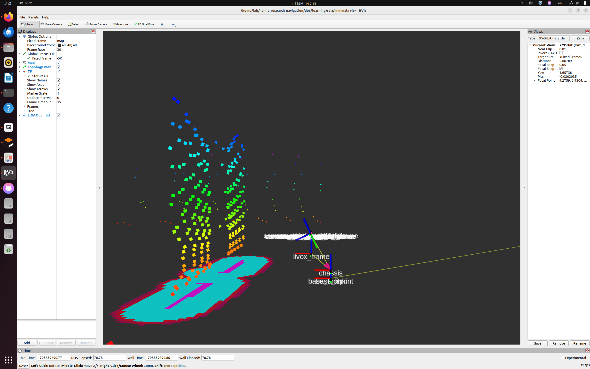

# 阶段 3 · 定位与 TF

- 日期：2026-11-05
- 对应计划：[阶段 3](../PLAN.md)
- 状态：已验收（A–G 七组实验完成，产物已归档）
- 交付物：`doc/learning/notes/assets/stage-03-tf-tree.pdf`、`stage-03-tf-axes.png`

> 下表数值为本工作区的**实测基线**（阶段 0 复现时已验证）。你自己复现的结果若与基线不同，直接覆盖，并在第 6 节写明差异。

## 1. 目标

能用自己的话讲清 `map → base_link` 是怎么来的、为什么本项目没有 `odom` 坐标系，并会用 `tf2_echo` / `view_frames` / `tf2_monitor` 三个工具定位 TF 问题。

## 2. 命令与输出记录

| # | 实验 | 命令 | 基线结果 |
| --- | --- | --- | --- |
| A | 雷达外参 | `ros2 run tf2_ros tf2_echo base_link livox_frame` | `Translation: [0.240, 0.000, 0.300]`，四元数 `[0,0,0,1]` |
| B | 整棵 TF 树 | `ros2 run tf2_tools view_frames` | 生成 `frames_*.pdf`；根为 `map`，动态边 `map→base_link`，**无 `odom` 节点** |
| C | 里程计一致性 | `ros2 topic echo /odom --once --field pose.pose.position` + `tf2_echo map base_link` | 两组 x/y 一致；TF 的 z 恒为 `0.000` |
| D | 频率/延迟 | `ros2 run tf2_ros tf2_monitor map base_link` | `/odom` ≈ 96 Hz；TF delay 毫秒级 |
| E | RViz 看 TF | `rviz2 -d doc/learning/rviz/minimal.rviz`，TF 勾 `Show Names`/`Show Axes`，Focal Point `8;8;0` | 三个坐标系贴在车上，`livox_frame` 在车头前上方 |
| F | 读代码 | 读 [onOdom()](file:///home/lxh/nanhu-research-navigation/src/navigation2/bridge/nav2_input_bridge/src/input_bridge_node.cpp#L245-L315) | 七问作答见第 5 节 |
| G | 改偏移 | `body_offset_x: 0.0 → 0.1` 后重启 T3 | `map→base_link` 的 x 比 `/odom` 大约多 0.1 m；已改回 `0.0` ✅ |

> 实验 G 还原确认：`grep body_offset src/robot_launch/config/gazebo_net_nav.yaml` 三行均为 `0.0`。

## 3. 本项目的 TF 树

```text
map
└── base_link                    ← input_bridge 动态发布（每帧 /odom 一条，≈96 Hz）
    └── base_footprint           ← 静态：launch 里的 static_transform_publisher（恒等）
        ├── chassis              ← robot_state_publisher：xyz=(0,0,0.10)
        │   └── livox_frame      ← robot_state_publisher：xyz=(0.24,0,0.20)
        └── 各轮 link
```

由此得到 `base_footprint → livox_frame = (0.24, 0, 0.30)`，与实验 A 一致。

| TF 边 | 发布者 | 类型 |
| --- | --- | --- |
| `map → base_link` | `nav2_input_bridge` | 动态 |
| `base_link → base_footprint` | `static_transform_publisher` | 静态 |
| `base_footprint → chassis/livox_frame` | `robot_state_publisher` | 静态 |
| 底盘插件 `odom → base_footprint` | **已关闭**（`publish_odom_tf=false`） | — |



*图中可见 `livox_frame`、`chassis`、`base_footprint` 三组坐标轴；`livox_frame` 在车头前上方，与 (0.24, 0, 0.30) 一致；青色为代价地图的膨胀带。*

完整 TF 树由 `view_frames` 导出，已归档为 [`assets/stage-03-tf-tree.pdf`](assets/stage-03-tf-tree.pdf)。

## 4. 关键结论

1. REP-105 三层坐标系里，`odom` 连续但漂移、`map` 不漂但会跳；仿真里轮速里程计就是真值，所以本项目跳过 `odom`，直接发 `map → base_link`。
2. 全项目只有一条 `map → base_link` 发布链；底盘插件的 `publish_odom_tf` 必须关掉，否则同一子节点被两条链抢，RViz 里会抖动/瞬移。
3. TF 的 z 被强制为 0：2D 导航只在平面内规划，坡道靠 `slope_traversability_layer` 单独处理。
4. `body_offset` 是把定位原点从 IMU 挪到车体中心的修正项；仿真里 IMU 与车体中心重合，所以为 0，改它会让全部导航坐标整体平移。
5. `tf2_echo` / `view_frames` / `tf2_monitor` 分别回答「这条变换对不对」「树长什么样」「频率和延迟正常吗」三个问题。

## 5. TF 七问作答（参考答案）

1. **超时阈值**：`odom_timeout_s`（默认 2 s）；超时打 `odom_timeout` 错误日志，这是导航卡住的第一条排查线索。
2. **frame 重映射**：在 `onOdom()` 内把 `world → map`、`car1/base_link → base_link` 统一成导航栈认的名字。
3. **为什么用位姿差分**：上游定位只给位姿不给速度，桥用 `(p_now - p_prev)/dt` 自己算出 twist 再发布 `odom_local`。
4. **body_offset 作用**：把里程计原点平移到车体中心；仿真里为 0，真机上非 0。
5. **TF z=0**：2D 导航，避免坡道/悬空导致代价地图失效。
6. **QoS**：订阅端用 `SensorDataQoS`（best_effort）。best_effort 订阅端可以收 reliable 发布端的数据；真正不兼容的是「reliable 订阅端 + best_effort 发布端」——这正是 RViz 默认设置收不到 `cur_lid` 的原因。
7. **为什么关底盘 odom TF**：避免它发的 `odom → base_footprint` 与桥的 `map → base_link` 形成双链，导致 TF 抖动、costmap 反复重算。

## 6. 卡点 / 待补

| 现象 | 原因 | 处理 |
| --- | --- | --- |
| `frames_*.pdf` 未归档 | 生成在命令执行目录，未复制 | 已复制为 `assets/stage-03-tf-tree.pdf` ✅ |
| RViz 里 TF 轴“看不清” | 视角太远（阶段 2 同一个问题） | 放大到 Focal Point `(9.27, 9.05)` 后截图 ✅ |
| 自己的复现数值与基线不同 | 出生点/世界不同 | 在下方补一行差异说明即可 |

## 7. 自测题作答（参考答案）

1. `map` 与 `odom` 的本质区别？本项目为什么不设 `odom`？
   **答**：`odom` 连续但长期漂移，`map` 不漂但重定位时会跳；仿真里程计是真值无漂移，直接 `map → base_link` 即可，省掉一段拼接。
2. 哪一行代码保证 `map → base_link` 只有一条发布链？
   **答**：URDF/插件里 `publish_odom_tf=false`，加上桥里唯一的 `tf_broadcaster_->sendTransform(t)`。
3. `tf2_echo odom base_link` 为什么会失败？
   **答**：本项目 TF 树里根本没有 `odom` 这个 frame，查不到父子关系。
4. `body_offset_x` 改 0.1 后，导航点会怎样偏移？对穿门有什么影响？
   **答**：所有 `map` 系坐标整体前移 0.1 m；穿门时车头与门柱的实际间距会比规划值小 0.1 m，窄门余量（0.7−0.46=0.24 m）会被吃掉近一半。
5. 静态 TF 忘了 `use_sim_time: true` 会报什么错？
   **答**：静态边时间戳与仿真时间不同源，查询时报 `Lookup would require extrapolation into the future`。

## 8. 复习要点

1. `map→base_link` 由 `input_bridge` 发；`base_link→base_footprint→livox_frame` 全静态；没有 `odom`。
2. 外参 `base_link→livox` = (0.24, 0, 0.30)；TF 的 z 恒为 0。
3. 排障三步：`tf2_echo` 查值 → `view_frames` 查树 → `tf2_monitor` 查频率延迟。

## 9. 下次从哪继续

- [x] 归档 `frames_*.pdf` → `notes/assets/stage-03-tf-tree.pdf`
- [x] 归档车附近 TF 轴截图 → `notes/assets/stage-03-tf-axes.png`
- [ ] 进入阶段 4：拓扑路网 + 全局规划
